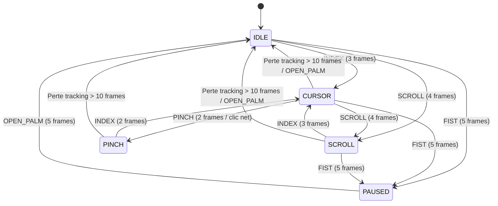

# Spécification des Règles de Transition — Hand Control

Ce document détaille l'ensemble des règles de transition d'états, des seuils d'hystérésis et des mécanismes temporels actuellement implémentés dans le moteur gestuel ([temporal_engine.py](file:///c:/Users/LOU/Documents/CDAR/Hand/App_C/gestures/temporal_engine.py)).

---

## 1. Machine à états (FSM)

---

## 2. Tableau des règles de transition (`TRANSITION_RULES`)

Chaque transition entre un état source (`from_state`) et un état cible (`to_state`) obéit à trois paramètres stricts :
- **`min_frames`** : nombre minimal d'images consécutives où le geste cible doit dominer pour valider le changement d'état.
- **`cooldown`** : nombre d'images consécutives immédiatement après la confirmation durant lesquelles **aucun autre changement d'état n'est autorisé** (évite les rebonds et oscillations).
- **`freeze_input`** : fige complètement l'émission des commandes système (`pyautogui`) pendant la fenêtre de transition pour éviter les gestes parasites et le dérapage de la souris.

| Transition (`from` $\rightarrow$ `to`) | `min_frames` | Durée @30 FPS | `cooldown` | `freeze_input` | Objectif & Comportement |
|---|:---:|:---:|:---:|:---:|---|
| **`CURSOR` $\rightarrow$ `PINCH`** | **2** | ~66 ms | 3 frames | **Oui** | **Clic instantané et ultra-réactif.** Le curseur se fige à l'approche puis le clic gauche atomique se déclenche en 2 frames. |
| **`PINCH` $\rightarrow$ `CURSOR`** | **2** | ~66 ms | 2 frames | **Oui** | **Reprise immédiate du curseur** dès que le pouce et l'index s'écartent. `pinch_clicked` est réinitialisé. |
| **`CURSOR` $\rightarrow$ `SCROLL`** | **4** | ~133 ms | 3 frames | **Oui** | Confirmation requise pour éviter de déclencher le scroll involontairement en déployant le majeur. |
| **`SCROLL` $\rightarrow$ `CURSOR`** | **3** | ~100 ms | 3 frames | **Oui** | Retour fluide au pointage dès que le majeur est replié. |
| **`SCROLL` $\rightarrow$ `PINCH`** | **5** | ~166 ms | 4 frames | **Oui** | **Sécurisé contre les faux clics.** Empêche qu'une fermeture de main depuis le scroll n'intercepte un clic parasite. |
| **`PINCH` $\rightarrow$ `SCROLL`** | **4** | ~133 ms | 3 frames | **Oui** | Transition protégée entre un clic et un défilement. |
| **`IDLE` $\rightarrow$ `CURSOR`** | **3** | ~100 ms | 2 frames | Non | Entrée naturelle en mode pointage dès présentation de l'index. |
| **`IDLE` $\rightarrow$ `SCROLL`** | **4** | ~133 ms | 2 frames | Non | Entrée sécurisée en mode défilement. |
| **`IDLE` $\rightarrow$ `PINCH`** | **4** | ~133 ms | 3 frames | Non | Empêche un clic accidentel dès l'entrée de la main dans le champ de la caméra. |
| **`ANY` $\rightarrow$ `PAUSED`** (`FIST`) | **5** | ~166 ms | 8 frames | **Oui** | **Mise en pause délibérée.** Exige 5 frames stables pour éviter toute mise en pause accidentelle lors d'une transition rapide. |
| **`PAUSED` $\rightarrow$ `IDLE`** (`OPEN_PALM`) | **5** | ~166 ms | 8 frames | **Oui** | **Reprise sécurisée.** Exige de montrer la paume ou le dos de la main ouverte pendant 5 frames avant de réactiver le contrôle. |
| **`DEFAULT` $\rightarrow$ `DEFAULT`** | **3** | ~100 ms | 3 frames | **Oui** | Règle de repli pour toute transition non spécifiée. |

---

## 3. Seuils d'hystérésis (`HYSTERESIS`)

L'hystérésis empêche les oscillations lorsque deux gestes sont proches (par exemple `INDEX` et `SCROLL` quand le majeur hésite). Pour qu'un nouveau geste prenne le contrôle, son score lissé (EMA) doit dépasser son **seuil d'entrée**. L'état actif ne perd le contrôle que si son score descend sous son **seuil de sortie**.

$$\text{Seuil d'entrée} > \text{Seuil de sortie}$$

| Geste | Seuil d'entrée (`entry`) | Seuil de sortie (`exit`) | Marge anti-oscillation |
|---|:---:|:---:|:---:|
| **`INDEX`** | `0.62` | `0.48` | `0.14` |
| **`SCROLL`** | `0.68` | `0.52` | `0.16` |
| **`PINCH`** | `0.50` | `0.38` | `0.12` |
| **`FIST`** | `0.68` | `0.52` | `0.16` |
| **`OPEN_PALM`** | `0.68` | `0.52` | `0.16` |

---

## 4. Filtrage temporel et calcul de l'EMA

Les scores bruts de chaque frame sont lissés par une moyenne mobile exponentielle (EMA) :

$$EMA_t = EMA_{t-1} \cdot (1 - \alpha) + \text{score}_t \cdot \alpha$$

- **Facteur standard** : $\alpha = 0.40$ (équilibre optimal entre stabilité du curseur et réactivité des gestes continus comme `SCROLL`).
- **Boost réactivité du `PINCH`** : dès qu'un pincement franc est détecté ($\text{score} \ge 0.65$), $\alpha = 0.60$ pour le `PINCH` et l'inertie résiduelle de `INDEX` est immédiatement écrêtée à $0.20$. Cela permet au candidat `PINCH` de démarrer sans attendre 3 frames de décroissance artificielle de l'index.
- **Décroissance des gestes absents** : seuls les gestes non présents dans la frame courante subissent la décroissance naturelle $(1 - \alpha)$, évitant la double pénalité.

---

## 5. Verrous de sécurité et discriminations géométriques

### A. Discrimination `PINCH` vs `FIST` (fermeture de la main)
Lorsqu'un utilisateur ferme la main pour faire un `FIST`, le pouce et l'index se croisent brièvement. Pour empêcher que ce mouvement ne soit interprété comme un `PINCH` (faux clic) :
1. **Distance Index–Majeur (`dist(8, 12)`)** :
   - Dans un `FIST`, les extrémités de l'index (8) et du majeur (12) sont toutes deux recroquevillées côte à côte dans la paume ($\text{dist} < 0.30 \times \text{palm\_width}$).
   - Dans un vrai `PINCH`, l'index est décollé dans l'espace vers le pouce, loin du majeur ($\text{dist} > 0.35 \times \text{palm\_width}$).
   - $\rightarrow$ **Si l'index et le majeur sont collés dans la paume, le score de `PINCH` est immédiatement forcé à `0.0`.**
2. **Rétraction basale (`dist(8, 5)`)** :
   - Si l'extrémité de l'index est rétractée contre sa jointure MCP 5 ($\text{dist} < 0.38 \times \text{palm\_width}$), le geste est classé comme replié et non en pincement.
3. **Exigence d'index actif** :
   - Un pincement exige que l'index ne soit pas replié à plat ($\text{score}_{\text{index}} \ge 0.25$).
   - Un poing exige que l'index soit complètement replié ($\text{score}_{\text{index}} \le 0.35$).

### B. Gel anticipé du curseur à l'amorce du clic (`pinch_freeze_threshold`)
- Seuil : $\text{pinch\_dist} < 0.28 \times \text{palm\_width}$.
- Dès que le pouce et l'index s'approchent pour toucher, le déplacement du curseur est gelé dans [input_controller.py](file:///c:/Users/LOU/Documents/CDAR/Hand/App_C/gestures/input_controller.py) **avant même** la confirmation de l'état `PINCH`.
- Ce seuil resserré à 0.28 (au lieu de 0.52) garantit que l'inclinaison directionnelle de l'index dans toutes les directions (gauche, droite, bas, diagonales) ne gèle jamais le curseur en plein vol.

### C. Protection anti-confusion de l'index directionnel (`CURSOR` vs `PINCH`)
1. **Immunité du pointeur rectiligne** :
   - Si l'index est tendu droit en position de pointage ($	ext{score}_{	ext{index}} > 0.65$ et $	ext{dist}(8, 5) > 0.88 	imes 	ext{palm\_width}$), tout `PINCH` est strictement forcé à `0.0` sauf si la distance tombe sous le contact franc ($\le 0.20$).
2. **Conservation du score `INDEX` lors de l'inclinaison** :
   - L'index conserve 100% de son score géométrique tant que $	ext{pinch\_dist} \ge 0.28$, permettant d'orienter le doigt à $360^\circ$ sans aucune perte d'état ni faux clic.

### D. Tolérance aux pertes de tracking (`LOST_FRAMES`)
- **Perte courte ($\le 10$ frames, ~330 ms)** : si la qualité chute ($< 0.25$) ou si une frame est `UNKNOWN` (occultation passagère, mouvement rapide), l'état actif est **maintenu intact** sans interruption de l'action en cours.
- **Perte prolongée ($> 10$ frames)** : l'état bascule proprement vers `IDLE`, relâchant tous les boutons et réinitialisant les deltas de mouvement.

